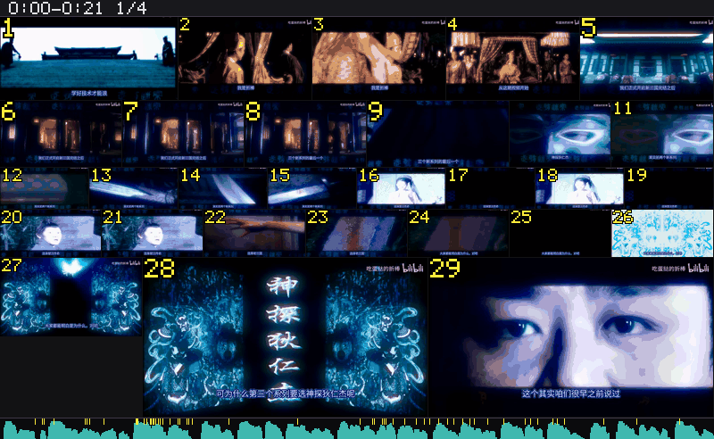
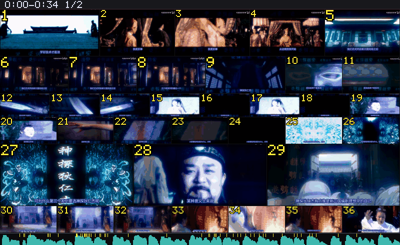
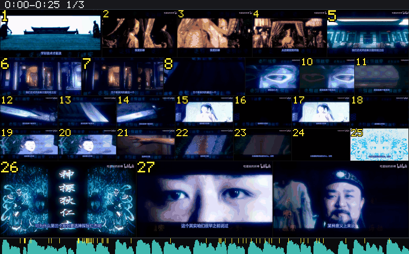
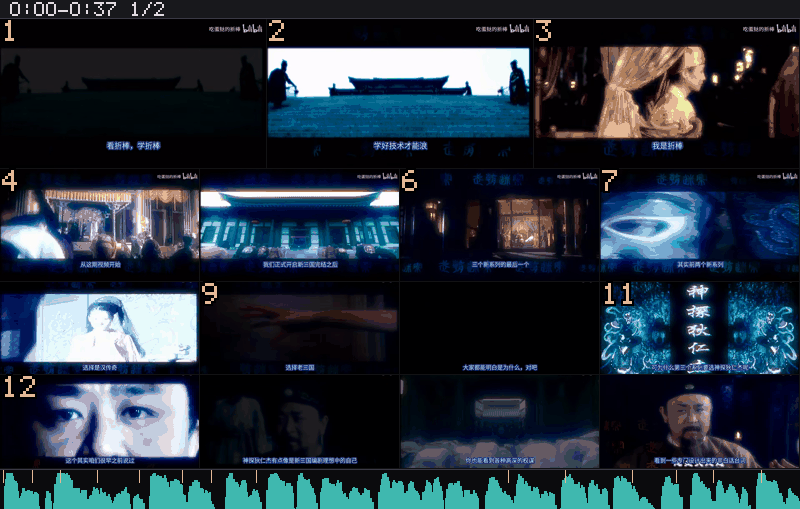

# 分镜（coopanion-video-storyboard）

Coopanion / Cortico 的 World：把视频变成可引用的分镜宫格图，附一份带时间码的清单。
四个工具（storyboard / probe / locate / zoom）、两套引擎（v1 默认 / v2 可选）、本地 whisper.cpp 转写、
硬字幕 OCR 纠正、可插拔的切点检测。

> **Fork 声明**：本项目是基于 [`SAOS-3624/dsh-video-storyboard`](https://github.com/SAOS-3624/dsh-video-storyboard)
> （Apache-2.0，v0.6.0 / 提交 `e124ae6`）的移植与再打包。上游的 `LICENSE` 与 `NOTICE` 原样保留在仓库根目录，
> 算法层位于 `src/vendor/storyboard/` 与 `src/vendor/storyboard-v2/`，各自的 `VENDOR.md` 记录了逐文件的改动。

零运行时依赖（`dependencies` 为空）。外部程序 ffmpeg / ffprobe / yt-dlp / whisper.cpp / Python 都由使用者
显式安装或指定。

包本身不自动安装任何可执行文件；只有你在服务页点「一键安装」时，才会按需下载
**whisper.cpp 运行时**（zip，校验 sha256）、**whisper 模型**（ggml-*.bin）和
**OCR 的 Python wheel**（清单里逐条带 sha256，缓存到数据目录）。装的时候可以只看它跑到哪一步，
装完也不会有后台偷偷下载。

> 带图的展示页（安装步骤 + 六组真跑对比 + token 消耗与省钱旋钮）：https://yuyindajiang.github.io/coopanion-video-storyboard/ ——纯静态，浏览器直接打开。

## 它能干什么

一支视频丢进来，出来一张**分镜宫格图**和一份**带时间码的清单**：每个格子是一个镜头，标着编号和时间范围，可以直接引用「cell 7 = 00:12.76–00:31.40」。

格子按镜头的稠密程度分配大小：一个 20 秒的长镜头给整幅宽，一串 0.3 秒的蒙太奇缩成 1/8 格。所以一张图能装下几十个镜头，又不会为了快剪白白浪费 token。

四个工具，各管一段：

| 工具 | 干什么 | 什么时候用 |
|---|---|---|
| `video_probe` | 只读文件头：多长、多大、有没有字幕轨 | 动手之前先看看这片子值不值得读 |
| `video_storyboard` | 出宫格图 + 时间码清单，带本地转写与硬字幕 OCR | 想快速看懂一支片子、写摘要、做解说稿 |
| `video_locate` | 只查台词，不取帧，纯文本返回 | 「这片子哪一秒说到了 X」 |
| `video_zoom` | 把某一格那几秒放大重读 | 字幕、人名、小字看不清时 |

一个真数：一支 24 分钟影视解说，**37 张图、14,208 token** 就能把全片过一遍；同一支片子改用上游默认的切点检测，是 94 张图、36,096 token（1440 秒全片，分五段跑，两组参数相同）。

## 升级与安全（cookies）

**0.8.11 及更早版本会把浏览器里「全域名」的 cookie 明文写到** `%USERPROFILE%\.dsh\bili-cookies-from-browser.txt`。

- **升级到新版**：启动时自动删除该文件，日志里会有一行「已清理遗留的 cookie 文件」
- **不打算升级**：手动删只是**临时措施**——旧版每次取字幕/调试都会重新落一次盘，删了下次还会有；所以**建议直接升级**
- 新版行为：只取 `bilibili.com` 域、写到本扩展自己的数据目录、**用完即删**（`try/finally`），启动时还会扫一遍残骸

细节与「为什么不改成完全不落盘」的评估见 [`docs/cookie-handling.md`](docs/cookie-handling.md)。

**删除本扩展时**：Coopanion 的弹窗明确写「不会删除 Memory、已有配置或本地扩展源码」，所以
`<dataDir>\storyboard\tmp` 会留在盘上，需要手动删除。正常使用时那里不会有 cookie 文件（用完即删），
只有在下载过程中崩溃才可能残留；下次启动本扩展时会自动清掉那个残骸。

## 长什么样

**积分伪切点：`integral` 开 vs 关**（同一支片子、同一套参数，只切这一项）

| `integral: true` — 长镜头内部多出重复格 | `integral: false` — 一格一句话 |
|---|---|
|  |  |

**切点检测：上游 vs 自带**（`detect` 默认 upstream，`detect:"own"` 走本仓库的检测器）

| 上游 `upstream` | 自带 `detect: "own"` |
|---|---|
|  |  |

更多对比（六组真跑、token 消耗、省钱旋钮）在展示页。

## 与上游的差异

算法层几乎原样，改动集中在「落点」和「新增能力」两类：

| 文件 | 改动 |
|---|---|
| `src/vendor/storyboard/world-paths.js` | 新增：把 cache / temp / media 三个根注入上游 |
| `src/vendor/storyboard/cache.js` | `cacheDir()` 先看注入的根（上游用 `%LOCALAPPDATA%`） |
| `src/vendor/storyboard/subtitles.js`、`ocr-subs.js` | 临时目录从系统 temp 改到 World 自己的 `tmp/` |
| `src/vendor/storyboard/media-store.js` | `mediaDir()` 与磁盘余量检查改走注入的根 |
| `src/vendor/storyboard/ytdlp.js` | 子进程注入 `TMP`/`TEMP`（PyInstaller 需要可写临时目录） |
| `src/vendor/storyboard/pipeline.js` | 音频分析按 (文件, 窗口) 缓存；`precomputed` 钩子接住 `stats/means/frames/degraded` 并校验 `prints`；静态画面提示 |
| `src/vendor/storyboard/asr.js` | initial prompt 进缓存键；`DSH_ASR_PROMPT` 可配 |
| `src/vendor/ocr_bridge.py` | 新增 `lines` 模式（逐图返回文字行 + 行框） |

本仓库自己新增（不在上游里）：

- **切点检测 v1**：`detect:"own"` 时用 `src/precomputed/detect.js`（裁底部字幕带 → 直方图差 → 三点一致性 → 短镜头合并），经 `precomputed` 钩子喂给同一套 `runStoryboard`
- **硬字幕 OCR 纠正**：`src/vendor/storyboard/ocr-align.js`（自适应行框 + 4 帧投票 + 同音闸门 + 简繁归一）
- **分析资产复用**：`src/precomputed/`（一次扫描落盘，plan / render 反复用）
- **一键安装五项**：whisper 运行时 / 模型 / Python venv / wheel 缓存 / 离线 pip，逐项 skip 或装
- **体检表 Python / OCR 两行**：判据 Python 3.11–3.13，缺什么写什么
- **静态画面提示**：画面几乎不动（PPT / 讲课）且出现积分伪切点时，清单会多一行 `hint:`，建议用 `integral:false` 重跑——一格一句话，不再有重复帧

## 这个包为什么长得是这样

Cortico 的 World 契约里，**`package.json` 没有 `id` 也没有 `pages`**。真正决定这两件事的：

| 你想要的 | 实际住在哪 | 本包的值 |
|---|---|---|
| World id | 入口 `export default` 出来的定义对象的 `id` | `src/index.js` → `id: 'storyboard'` |
| 页面 id（导航里那一页） | 由 World id 派生：`world:<id>` | `world:storyboard` |
| 页里的标签（「服务」这些） | 实例的 `webUi(language).panels[]` | `src/world.js` → `webUi()` |
| 标签的内容 | 浏览器产物里 `panels` 的键（必须同名） | `dist/webui.js` → `export default { panels: { service } }` |
| 数据面 | 实例的 `webUi().invoke(panel, method, args)` | `src/world.js` → `invoke()` |

`cortico` 块里认的字段只有：`kind`、`api`、`displayName`、`locales`、`icon`、`webUiClient`、
`webUiStyle`、`describe`、`tags`、`screenshots`。**写别的键不会报错，会被静默忽略** ——
在 `package.json` 里写 `pages` 正是“装了但没有页”的一种典型原因。

## 目录

```
package.json         cortico 清单（kind/api/displayName/webUiClient/webUiStyle/describe）
describe.json        工具自描述（由 scripts/gen-describe.mjs 从 def.describe 生成）
src/index.js         WorldDefinition：id / label / defaults() / create()
src/world.js         实例：start/stop、tools()、webUi()、invoke()
src/health.js        ffmpeg/ffprobe 体检（只报告，不下载）
src/state.js         state.json 的原子读写
src/tool-schema.js   上游紧凑写法 → 标准 JSON Schema
src/tools/
  video-storyboard.js  video_storyboard：出图 + 清单；字幕护栏；落点
src/vendor/storyboard/ 上游算法层 36 个文件（见该目录 VENDOR.md）
dist/webui.js        浏览器端 bundle（无 import，导出 panels.service）
dist/webui.css       仅补本页排版，其余复用宿主样式
scripts/gen-describe.mjs  重新生成 describe.json
scripts/check.mjs    不启动 Coopanion 的契约自检：node scripts/check.mjs
```

## 工具

| 工具 | 状态 |
|---|---|
| `storyboard_status` | 已搬：ffmpeg/ffprobe/yt-dlp、缓存、ASR 配置的只读体检 |
| `video_storyboard` | 已搬：出分镜宫格图 + 可引用清单；`engine: v1 \| v2` |
| `video_probe` | 已搬：只读容器头，不出图、不下载 |
| `video_locate` | 已搬：纯文本定位台词，不取帧 |
| `video_zoom` | 已搬：按 cellId 或时间窗重看一段 |

## 分析资产复用 / seen before

这两条是从 V2 分支单独拿过来的思路，没有并整套代码：

- **复用**：同一 (文件, 窗口) 下换格数、档位或预算时，scan 与音频分析都不重算
  （v1 本来就缓存 scan / transcript，音频这一层是本包补的）。清单开头会打印
  `reused from the analysis cache: scan, audio`。实测同窗口换格数：2.2 s → 0.2 s。
- **seen before**：跑之前读 `seen.jsonl`，把"这部片子之前看过哪几段"写在清单前面。
  v1 一直在写这条记忆，只是从来没读过。

## 两个引擎

`video_storyboard({ …, engine: "v1" })` 是默认（main 0.6.0 的档位排布）。`engine: "v2"` 走
`feature/high-performance` 分支（0.3.0 的 coverage 选帧），代码在 `src/vendor/storyboard-v2/`。

两套算法互不共用模块，缓存/临时/下载缓存也分开：

```
<dataDir>/cache   <dataDir>/tmp   <dataDir>/media      ← v1
<dataDir>/v2/cache  <dataDir>/v2/tmp  <dataDir>/v2/media  ← v2
```

V2 没有取流层：`engine:"v2"` 时由适配层用 yt-dlp 把片子下到 `v2/media` 再喂给它。
`transcriptFile` 只有 v1 认。

## 本地 ASR

服务页「语音识别（本地）」一卡管完：安装依赖、启动 / 停止 / 重启、模型下拉、识别提示词。

**模型下拉扫的是 `<dataDir>/asr/models/*.bin`**（默认 `…\storyboard\asr\models`），
文件名去掉 `.bin` 就是 id，大小后面的数字是实际文件大小。往里丢一个 `ggml-*.bin` 再刷新页面就会出现，
不用改代码；内置能自动下载的只有 small / medium 两档。

**切档位 = 换进程**：whisper.cpp 的模型是 `-m` 启动参数，没有运行时换模型的接口，
所以选中后会停掉当前 whisper-server、等它退出、再带新 `-m` 起一个，并重建代理。
切换期间状态是"正在重启…"，页面每 3 秒轮询一次，完成后显示"运行中 + 端口"。

**默认档位**：`defaults().whisperModel = 'ggml-small-q5_1.bin'`，首次装配写进
`worlds.storyboard.whisperModel`，之后以 `config.json` 为准；老配置里的 `small` / `medium` 会自动映射到文件名。

| 档位 | 大小 | RTF（实测 103 s 音频） |
|---|---|---|
| small-q5_1 | 181 MB | 0.079 |
| medium-q5_0 | 514 MB | 0.222 |

同一条片子上 medium 更慢、输出还变成繁体，所以默认留在 small；换片源时可以在下拉里自己挑。

## 外部程序

| 程序 | 什么时候需要 | 怎么找 |
|---|---|---|
| `ffmpeg` / `ffprobe` | 永远 | 管理页填路径；留空则从 PATH 找 |
| `yt-dlp` | 只有贴链接（B 站等）时需要 | 顺序：管理页填的路径 → `PATH` → `%APPDATA%\Python\*\Scripts\yt-dlp.exe`（pip 的落点） |

三者都不由本包下载或安装。找不到时管理页会指名道姓，`video_storyboard` 也会在失败回执里说清缺哪个。

本机文件认 `.srt` 与 JSON（自动识别形制）；`.ass` 不解析，直接报错并要求先
`ffmpeg -i x.ass x.srt`。**不会去同目录找同名`.srt`**——要台词就显式传 `transcriptFile`。

缓存、临时文件、下载缓存都在 World 数据目录里：`<dataDir>/storyboard/{cache,tmp,media}`。

## 从本机目录安装

1. **先完全退出 Coopanion**（托盘右键 → 退出）。World 只在进程启动时加载，没有热重载。
2. 把整个目录复制（或做 junction）到扩展目录：
   `%LOCALAPPDATA%\Programs\Coopanion\data\extensions\node_modules\coopanion-video-storyboard`
3. 在 `%LOCALAPPDATA%\Programs\Coopanion\data\extensions\package.json` 的 `dependencies` 里加一行：
   `"coopanion-video-storyboard": "link:<path-to-this-repo>"`
   （复制安装则用 `"file:<path-to-this-repo>"`。）
4. 启动 Coopanion → 设置窗口 → World → 「分镜」→ 启用。

依赖不需要手工装：服务页「一键安装（small）」会分五项处理（whisper 运行时、模型、Python venv、
wheel 缓存、离线 pip），已存在的逐项跳过。**OCR 需要 Python 3.11–3.13**——这个 Python 只为装
rapidocr 用；可以自己装，也可以用别的方式装 rapidocr（体检表会把「有没有 / 版本对不对」写清楚）。

## 用法（`video_storyboard` 的五个开关）

五个参数都是可选的，默认值保持上游行为；按需打开即可。

| 参数 | 取值 | 用途 |
|---|---|---|
| `integral` | `true`（默认）/ `false` | 是否在长镜头内部**按画面变化补采样帧**。补出来的时刻不是真切点（业内叫"伪切点"），静态画面里会把一张幻灯片切成好几格。**幻灯片 / 讲课 / 长时间停在字上**的片子建议 `false`：一格一句话，不再有重复帧 |
| `integralSeconds` | `1`–`30`，默认 `6` | 只在 `integral:true` 时有效。**值越小补得越多**（每累积 `N` 秒的"画面变化量"就补一帧）；静态素材调到 `12`–`20` 能明显减少重复格 |
| `detect` | `"upstream"`（默认）/ `"own"` | 切点检测器。`own` 是我们那套：裁掉底部字幕带 → 直方图差 → 三点一致性 → 短镜头合并；B 站这种**底部有硬字幕**的片子用它切点会干净很多。只在同时给了 `precomputed:"auto"` 时生效 |
| `precomputed` | `"off"`（默认）/ `"auto"` | 分析资产复用：第一次扫描的结果落盘（`<dataDir>/precomputed/`），之后换格数 / 换档位 / 换窗口都直接读盘，不再解码整片。回执里会写明 `hit(...)` 还是 `miss→built(...)` |
| `transcript` | `"auto"`（默认）/ `"off"` | 台词来源。`auto` = 有内嵌字幕轨就用，没有就本地 ASR；`off` = 完全不要台词（只出图，最省时间） |
| `transcriptFile` | 本地路径（`.srt` / JSON） | 显式指定字幕文件，**优先级最高**，会跳过字幕轨与 ASR。注意：不会去同目录自动找同名 `.srt`，必须显式传；`.ass` 不解析，先用 `ffmpeg -i x.ass x.srt` 转一道 |
| `tierMap` | 形如 `{ "3": 2, "4": 1 }` | 按段的**序号**覆盖格子档位（数字越大格子越大，1 = 整幅）。清单里会回显 `tierMap=3->2,4->1`，方便复核是否真的生效 |

最短示例（本地文件、关掉伪切点、用自己的检测器、复用扫描结果）：

```jsonc
{ "input": "D:/media/lecture.mp4", "from": 0, "to": 300,
  "integral": false, "detect": "own", "precomputed": "auto" }
```

只想要图、不要台词（最快）：

```jsonc
{ "input": "D:/media/clip.mp4", "transcript": "off" }
```

已有字幕文件时（跳过 ASR）：

```jsonc
{ "input": "D:/media/film.mp4", "transcriptFile": "D:/media/film.srt" }
```

> 画面几乎不动时，清单会多一行 `hint:`，建议用 `integral:false` 重跑 —— 那是自动判定的，不需要自己判断。

## 卸载

1. 退出 Coopanion。
2. 删 `...\data\extensions\node_modules\coopanion-video-storyboard`。
3. 删 `...\data\extensions\package.json` 里那一行依赖。
4. 可选，删干净状态：
   - `...\data\home\companion\data\storyboard`（`state.json` 与缓存）
   - `...\data\home\companion\config.json` 里的 `worlds.storyboard` 段

## 自检

```
node scripts/check.mjs
```

覆盖：manifest 合法性、`create()` 是否纯净、实例 id、工具形状、`webUi()` 是否声明了 `service`、
浏览器产物是否真的导出同名面板、`state → save → state` 回路、`state.json` 落盘、`clearCache`。
